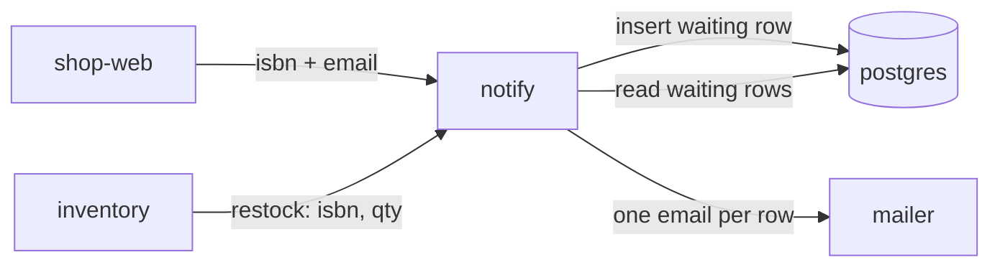

# Worked example (back-in-stock email)

Invented bookstore feature. Use it to see density and tone — do not paste it into an unrelated HLD.

A customer on an out-of-stock book page can leave an email. When copies arrive, they get one email, then the request is finished.

## 01 Why

**Out-of-stock pages cannot take an email**

The book page shows "Sold out" and nothing else. People email support, or keep refreshing.

- **400** "is this back?" tickets a month — support answers each one by checking the warehouse screen
- **2 days** median reply — the book is often already gone again
- **12,000** out-of-stock page views a week — **0** of them can leave an address

Goal — one email when copies arrive, sent the same day, without a support ticket.

## 02 System diagram

**One new notifier, everything else already exists**



Legend: **owned/changed** — shop-web (new button), notify (new). **External or shared** — inventory, postgres, mailer.

Edges: signup payload; restock event; waiting rows; outbound email.

## 03 Sequence

**40 copies of one book arrive, 25 people waiting**

1. Warehouse → inventory: receive 40 copies of ISBN `9780134685991`
2. inventory → postgres: stock for that ISBN goes from 0 to 40
3. inventory → notify: one event, `{ isbn, qty: 40 }` — not one event per copy
4. notify → postgres: `SELECT` waiting rows for that ISBN
5. 25 rows. If 0, stop here. No email, no further writes.
6. notify → mailer: 25 emails, one batch
7. notify → postgres: mark those 25 rows `sent`

A restock of 1 copy and a restock of 40 copies are the same number of steps. The only thing that grows is the email batch.

## 04 Schema & ERD

**One new table, two reused**

- `books` **REUSE** — isbn PK; title. 1:N → `stock_alerts`
- `stock` **REUSE** — isbn PK, FK to books; qty. No DDL. The restock already updates this row.
- `stock_alerts` **NEW** — id bigserial PK; isbn FK, cascade on book delete; email; status `waiting` | `sent`; created_at. UNIQUE (isbn, email) so the same person cannot sign up twice.

Migration order: 1 create `stock_alerts` and the unique index → 2 ship the button. No backfill. Old pages have no saved emails. Rollback: drop the table; the button hides when the route is gone.

## 05 API usage

`POST /books/9780134685991/notify-me` — one known book

Request:

```json
{ "email": "ada@example.com" }
```

Response `201`:

```json
{ "status": "waiting", "isbn": "9780134685991", "title": "The Pragmatic Programmer" }
```

- Duplicate signup — same email and ISBN returns `200` with the existing `waiting` row. No second email later.
- Unknown ISBN — `404`. Nothing is stored.
- Book already in stock — `409` with `{ "status": "in_stock", "qty": 3 }`. The page should show "Buy", not the form.

## 06 NFR & sizing

- **200** signups a day, last month's count of "is this back?" emails plus page views that bounced
- **5 minutes** from restock event to last email in the batch
- **50,000** waiting rows, a year of signups if nobody buys
- **Mailer down** — restock event stays on the queue and retries; no row is marked `sent` until the batch is accepted

| Dimension | Today | Target | Source of the number |
| --- | --- | --- | --- |
| Signups / day | 0 (400 tickets / month instead) | 200 | Support tickets plus out-of-stock page views |
| Time to tell the customer | 2 days median | 5 minutes after restock | Chosen target; mailer p95 today is 20 seconds |
| Waiting rows | 0 | 50,000 | One year of the 200/day target |
| Emails per restock | n/a | one batch, capped at 500 | Mailer's documented batch limit |
| Degraded mode | support answers by hand | queue holds the event until mailer accepts it | Chosen target |

## 07 Testing

| BAND | CASE | PASS CRITERION |
| --- | --- | --- |
| Completeness | Signup, then a restock of that ISBN | One email, row moves `waiting` → `sent`, title in the body matches `books` |
| Completeness | Restock of an ISBN with no waiting rows | Sequence stops after the SELECT; mailer is not called |
| Edge cases | Same email signs up twice | Second call is `200`; still one email on restock |
| Edge cases | Unknown ISBN; book already in stock; empty email | `404`, `409`, `400`; no row written |
| Error handling | Mailer returns 503 | Rows stay `waiting`; event retries; no duplicate email after the retry succeeds |
| Error handling | postgres down on signup | `503` to the browser; no email queued |
| Non-functional | Batches of 1, 25, 500 waiting rows | Last email sent within 5 minutes; a 501st row is a second batch, not a dropped row |

## Open questions

### Q1: Does the customer need an account?
- Options: A email only, as above / B require a logged-in account and ignore the typed address
- Recommendation: A — most out-of-stock views are from people who are not logged in
- Needed from: product
