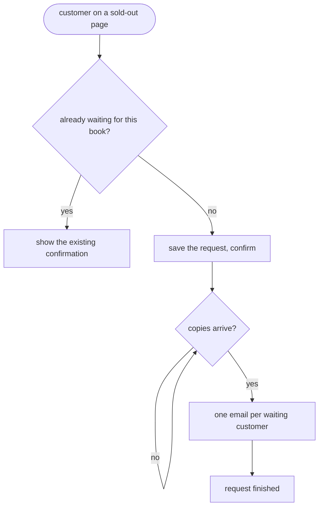
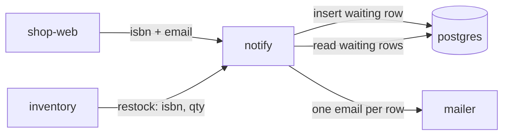

# Worked example (back-in-stock email)

Invented bookstore feature. Use it to see density and tone — do not paste it into an unrelated HLD.

A customer on an out-of-stock book page can leave an email. When copies arrive, they get one email, then the request is finished.

## 01 Why

**Out-of-stock pages cannot take an email**

The book page shows "Sold out" and nothing else. People email support, or keep refreshing.

- **G1 · 400** "is this back?" tickets a month — support answers each one by checking the warehouse screen
- **G2 · 2 days** median reply — the book is often already gone again
- **G3 · 12,000** out-of-stock page views a week — **0** of them can leave an address

Goal — one email when copies arrive, sent the same day, without a support ticket.

## 02 How

**Leave an address once; hear about it once**

1. **Sign up** — the customer on a sold-out page gives an email. Out: a "we'll tell you" confirmation. Closes G3.
2. **Wait** — nothing happens until copies of that book arrive.
3. **Notify** — when copies arrive, each waiting customer gets one email naming the book. Closes G1 and G2: the answer arrives the same day, with no ticket.
4. **Finish** — the request is marked done and never emails again.



When it can't help: a restock with nobody waiting does nothing. A book that comes back in stock before the customer signs up shows "Buy", not the form.

## 03 System diagram

**One new notifier, everything else already exists**



Legend: **owned/changed** — shop-web (new button), notify (new). **External or shared** — inventory, postgres, mailer.

Edges: signup payload; restock event; waiting rows; outbound email.

## 04 Sequence

**40 copies of one book arrive, 25 people waiting**

1. Warehouse → inventory: receive 40 copies of ISBN `9780134685991`
2. inventory → postgres: stock for that ISBN goes from 0 to 40
3. inventory → notify: one event, `{ isbn, qty: 40 }` — not one event per copy
4. notify → postgres: `SELECT` waiting rows for that ISBN
5. 25 rows. If 0, stop here. No email, no further writes.
6. notify → mailer: 25 emails, one batch; each email carries its `stock_alerts.id` as the idempotency key
7. notify → postgres: mark those 25 rows `sent`
8. notify acknowledges the restock event, only after step 7 commits

If step 7 fails after the mailer accepted the batch, the event is not acknowledged and is replayed. Step 6 runs again with the same keys, so the mailer drops the 25 duplicates and step 7 then succeeds. Each person still gets one email.

A restock of 1 copy and a restock of 40 copies are the same number of steps. The only thing that grows is the email batch.

## 05 Schema & ERD

**One new table, two reused**

- `books` **REUSE** — isbn PK; title. 1:N → `stock_alerts`
- `stock` **REUSE** — isbn PK, FK to books; qty. No DDL. The restock already updates this row.
- `stock_alerts` **NEW** — id bigserial PK; isbn FK, cascade on book delete; email; status `waiting` | `sent`; created_at. UNIQUE (isbn, email) so the same person cannot sign up twice.

Migration order: 1 create `stock_alerts` and the unique index → 2 ship the button. No backfill. Old pages have no saved emails. Rollback: drop the table; the button hides when the route is gone.

## 06 API usage

`POST /books/9780134685991/notify-me` — one known book

Request:

```json
{ "email": "ada@example.com" }
```

Response `201`:

```json
{ "status": "waiting", "isbn": "9780134685991", "title": "The Pragmatic Programmer" }
```

- Duplicate signup — same email and ISBN returns `200` with the existing `waiting` row. No second email later.
- Unknown ISBN — `404`. Nothing is stored.
- Book already in stock — `409` with `{ "status": "in_stock", "qty": 3 }`. The page should show "Buy", not the form.

## 07 NFR & sizing

- **200** signups a day, last month's count of "is this back?" emails plus page views that bounced
- **5 minutes** from restock event to last email in the batch
- **50,000** waiting rows, a year of signups if nobody buys
- **Mailer down** — restock event stays on the queue and retries; no row is marked `sent` until the batch is accepted
- **Mailer accepts, postgres write fails** — event is not acknowledged; the replay resends with the same idempotency keys, so the mailer sends nothing twice

| Dimension | Today | Target | Source of the number |
| --- | --- | --- | --- |
| Signups / day | 0 (400 tickets / month instead) | 200 | Support tickets plus out-of-stock page views |
| Time to tell the customer | 2 days median | 5 minutes after restock | Chosen target; mailer p95 today is 20 seconds |
| Waiting rows | 0 | 50,000 | One year of the 200/day target |
| Emails per restock | n/a | one batch, capped at 500 | Mailer's documented batch limit |
| Degraded mode | support answers by hand | queue holds the event until mailer accepts it | Chosen target |

## 08 Testing

| BAND | CASE | DEFENDS | PASS CRITERION |
| --- | --- | --- | --- |
| Completeness | Signup, then a restock of that ISBN | steps 1–8 (04) | One email, row moves `waiting` → `sent`, title in the body matches `books` |
| Completeness | Restock of an ISBN with no waiting rows | short-circuit at step 5 | Sequence stops after the SELECT; mailer is not called |
| Edge cases | Same email signs up twice | API idempotency (06) | Second call is `200`; still one email on restock |
| Edge cases | Unknown ISBN; book already in stock; empty email | API errors (06) | `404`, `409`, `400`; no row written |
| Error handling | Mailer returns 503 | mailer box (03), R1 | Rows stay `waiting`; event retries; no duplicate email after the retry succeeds |
| Error handling | Mailer accepts the batch, then the `sent` update fails; event replays | step 8 replay (04), R2 | Mailer receives the same 25 idempotency keys twice and sends 25 emails in total; rows end `sent` |
| Error handling | postgres down on signup | postgres box (03) | `503` to the browser; no email queued |
| Non-functional | Batches of 1, 25, 500 waiting rows | emails/restock row (07) | Last email sent within 5 minutes; a 501st row is a second batch, not a dropped row |

## 09 Risk

| ID | Risk | Likelihood | Impact | Mitigation | Owner |
| --- | --- | --- | --- | --- | --- |
| R1 | Mailer is down during a restock | Medium | Low | Event stays queued and retries; no row marked `sent` until the batch is accepted | notify on-call |
| R2 | Replay after a failed `sent` update double-emails | Low | High | Idempotency key per `stock_alerts.id`; test replays the batch | notify lead |
| R3 | Spam signups fill `stock_alerts` | Medium | Medium | UNIQUE (isbn, email); rate limit per IP | shop-web lead |

## 10 Monitoring

| Signal | Healthy | Ticket (working hours) | Page (wake someone) |
| --- | --- | --- | --- |
| Restock event to last email, p95 | ≤ 5 min | > 5 min for 30 min | > 30 min for 15 min |
| Signup `5xx` rate | < 0.1% | > 0.5% for 10 min | > 2% for 5 min |
| Events unacknowledged | 0 | any for 15 min | never pages |
| `waiting` rows | < 50,000 | > 40,000 | never pages |

Owner: notify team, runbook "notify-restock-lag". Reviewed monthly; alerts nobody acted on are demoted.

## Open questions

### Q1: Does the customer need an account?
- Options: A email only, as above / B require a logged-in account and ignore the typed address
- Recommendation: A — most out-of-stock views are from people who are not logged in
- Needed from: product

## Ship questions

- **Interface changes:** one new route and one new table; nothing existing changes, so no client migrates. Support is told so they can stop answering the tickets.
- **Scale:** the email batch grows first (capped at 500 per call); beyond it, further batches queue behind the first.
- **Error recovery:** in-flight restock events are unacknowledged until step 7 commits and replay safely (same idempotency keys). Bad data: stuck `waiting` rows older than 24 h with stock > 0 are found by a daily query and re-sent.
- **Rollout and recovery:** the button sits behind a `back_in_stock_form` flag that product can flip; off means "Sold out" as today. Rollback is dropping the table. At 3 a.m.: flip the flag off, check the mailer status page, replay the stuck events.
