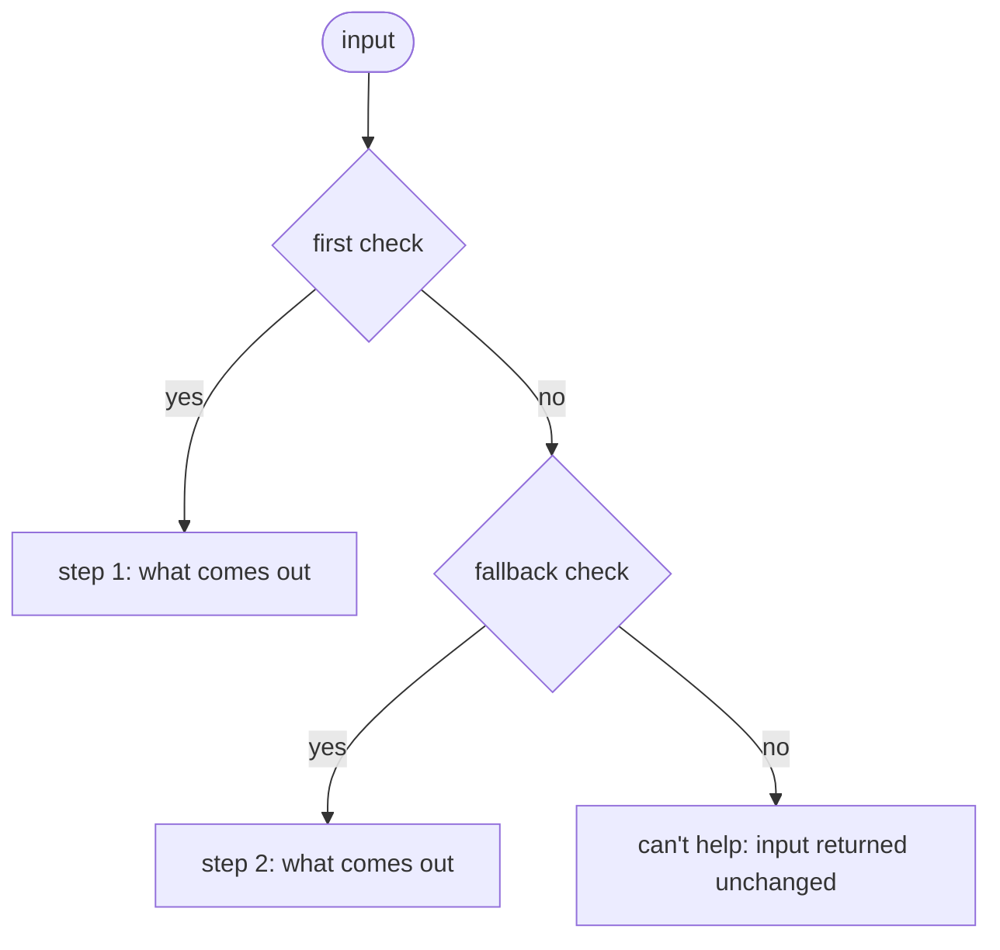
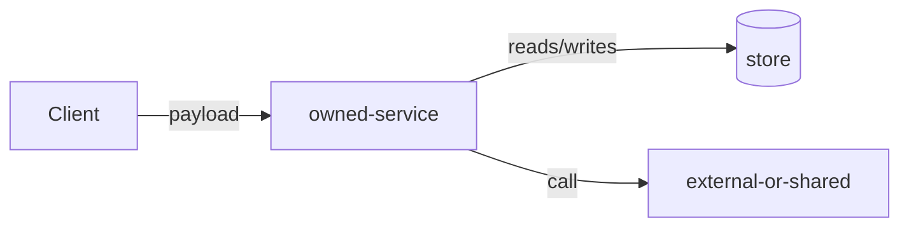
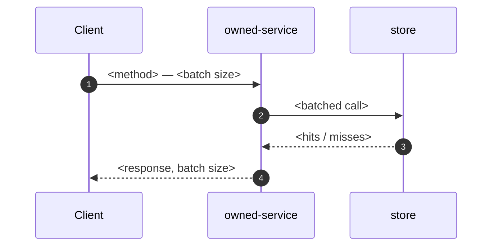
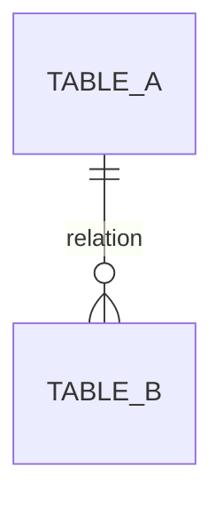

# HLD: <feature name>

- Status: draft
- Author:
- Date:
- Related tickets:

## 01 Why

Today:

Gaps:

G1. **<gap>** — <measured figure>
G2. **<gap>** — <measured figure>
G3. **<gap>** — <measured figure>

Who is blocked, and on what:

Why now:

Goal —

## 02 How

Form: flow chart | pseudo code | Gherkin | screen sequence. No services, tables or endpoints.



| Gap | Closed by |
| --- | --- |
| G1 | step 1 |
| G2 | step 2 |

When it can't help:

## 03 System diagram



Legend: **owned/changed** vs **external or shared**. New or changed boxes: …

## 04 Sequence

Hot path: <name the flow>



Short-circuits:

Scaling: <round trips> stay fixed whether the batch holds <small> or <large>.

## 05 Schema & ERD

| Table | Tag | Notes |
| --- | --- | --- |
| | NEW / REUSE / ALTER | indexes, uniqueness, cascades |



Migration order:

1.
2.

Blocking:

Backfill volume / duration:

Online?:

Rollback per step:

## 06 API usage

`METHOD /path`

Request:

```json
{}
```

Response (same case):

```json
{}
```

Changed vs today's contract:

Errors / partial success / idempotency:

## 07 NFR & sizing

- **** — 
- **** — 
- **** — 
- **** — 

| Dimension | Today | Target | Source of the number |
| --- | --- | --- | --- |
| Throughput | | | |
| Peak concurrency | | | |
| Latency p50 / p95 / p99 | | | |
| Data volume / growth | | | |
| Availability / degraded mode | | | |

## 08 Testing

| BAND | CASE | DEFENDS | PASS CRITERION |
| --- | --- | --- | --- |
| Completeness | | step N (04) | |
| Edge cases | | | |
| Error handling | | box (03) | |
| Non-functional | | row (07) | |

## 09 Risk

| ID | Risk | Likelihood | Impact | Mitigation | Owner |
| --- | --- | --- | --- | --- | --- |
| R1 | | | | | |

## 10 Monitoring

| Signal | Healthy | Ticket (working hours) | Page (wake someone) |
| --- | --- | --- | --- |
| | | > X for N min | > Y for M min |

Owner and runbook:

Reviewed (prune date):

## Open questions

### Q1: <decision>
- Options:
- Recommendation:
- Needed from:

## Ship questions

- **Interface changes:** contracts that change; backward compatible?; how long old clients work; who is told:
- **Scale:** what breaks first at 10×; cost that outgrows load; what is queued, shed or rejected:
- **Error recovery:** in-flight work when a dependency dies; retries idempotent?; how bad data is found and repaired:
- **Rollout and recovery:** feature flag and who flips it; fail-safe when off; rollback without data migration; first three steps at 3 a.m.:
