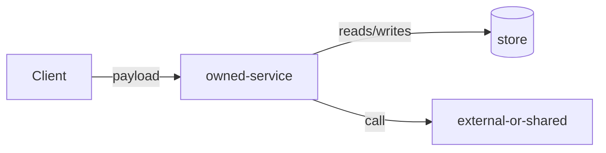
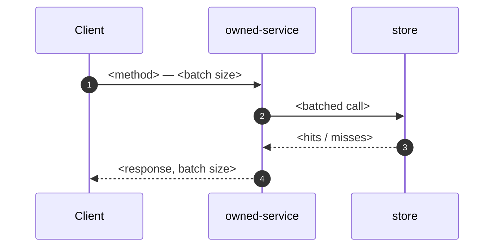
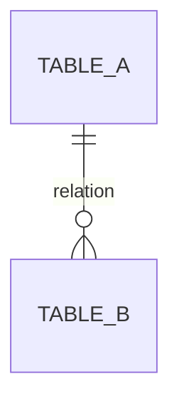

# HLD: <feature name>

- Status: draft
- Author:
- Date:
- Related tickets:

## 01 Why

Today:

Gaps:

1. **<gap>** — <measured figure>
2. **<gap>** — <measured figure>
3. **<gap>** — <measured figure>

Who is blocked, and on what:

Why now:

Goal —

## 02 System diagram



Legend: **owned/changed** vs **external or shared**. New or changed boxes: …

## 03 Sequence

Hot path: <name the flow>



Short-circuits:

## 04 Schema & ERD

| Table | Tag | Notes |
| --- | --- | --- |
| | NEW / REUSE / ALTER | indexes, uniqueness, cascades |



Migration order:

1.
2.

Blocking:

Backfill volume / duration:

Online?:

Rollback per step:

## 05 API usage

`METHOD /path`

Request:

```json
{}
```

Response (same case):

```json
{}
```

Changed vs today's contract:

Errors / partial success / idempotency:

## 06 NFR & sizing

- **** — 
- **** — 
- **** — 
- **** — 

| Dimension | Today | Target | Source of the number |
| --- | --- | --- | --- |
| Throughput | | | |
| Peak concurrency | | | |
| Latency p50 / p95 / p99 | | | |
| Data volume / growth | | | |
| Availability / degraded mode | | | |

## 07 Testing

| BAND | CASE | PASS CRITERION |
| --- | --- | --- |
| Completeness | | |
| Edge cases | | |
| Error handling | | |
| Non-functional | | |

## Open questions

### Q1: <decision>
- Options:
- Recommendation:
- Needed from:
